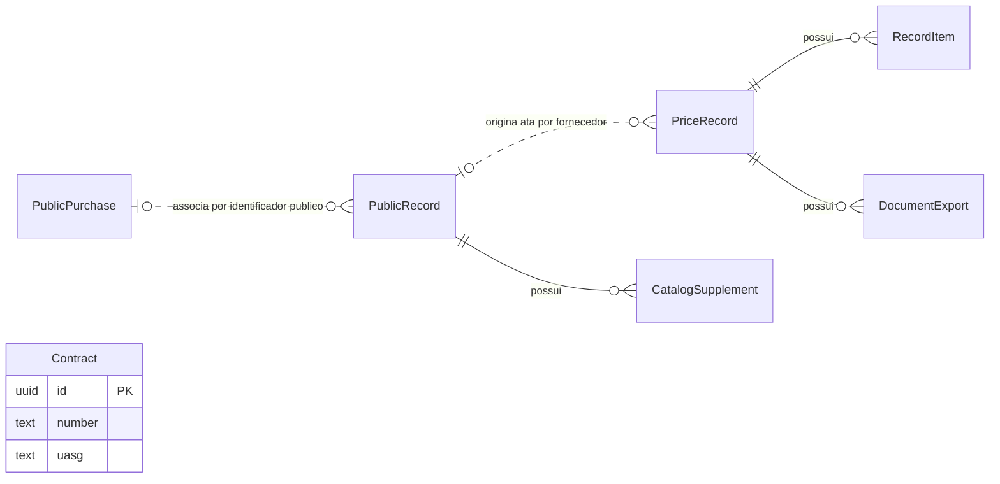

# Diagrama Entidade-Relacionamento

Modelo atual da aplicação Contracts Ext, baseado nos [tipos de persistência](../apps/api/src/models.ts), nas [migrações SQL](../apps/api/migrations/) e nos vínculos implementados no catálogo. Banco: PostgreSQL.

This diagram covers the existing contract and catalog tables in `public`. The
separate `finance` schema, including all fourteen tables and their relationships,
is documented in the [Financial data model](finance-data-model.md).

Historical migrations also retain `Institution`, `User`, `UserInstitution`,
`Session` and the `Role` enum for deployed-database compatibility. These legacy
tables are outside the active contract/catalog domain shown below; the current
API does not expose authentication routes.

## Visão geral

| Entidade | Papel na aplicação |
|---|---|
| `Contract` | Contrato cadastrado ou importado. |
| `PublicPurchase` | Pregão/compra pública salvo no catálogo local. |
| `PublicRecord` | Ata pública salva no catálogo local. |
| `CatalogSupplement` | Consulta auxiliar de participantes, empenhos/saldos ou adesões. |
| `PriceRecord` | Ata editável de um fornecedor, usada na geração de documentos. |
| `RecordItem` | Item da ata editável. |
| `DocumentExport` | Histórico de geração de DOCX/PDF, com cópia dos dados utilizados. |

## DER físico

As ligações abaixo são as três chaves estrangeiras existentes no banco. `PK` indica chave primária, `FK` chave estrangeira e `UK` unicidade individual. As restrições compostas estão na tabela após o diagrama. O comentário `opcional` indica coluna que aceita `NULL`; as demais são obrigatórias. `decimal_24_6` e `decimal_36_12` representam precisão e escala; `timestamp` representa `timestamp(3)`.

```mermaid
erDiagram
    direction LR

    PriceRecord ||--o{ RecordItem : "possui"
    PriceRecord ||--o{ DocumentExport : "registra geracoes"
    PublicRecord ||--o{ CatalogSupplement : "possui consultas auxiliares"

    Contract {
        uuid id PK
        text number
        text object
        text supplierName
        text supplierDocument
        text uasg
        text unitName
        text startDate "opcional"
        text endDate "opcional"
        decimal_24_6 initialValue
        decimal_24_6 globalValue
        text source
        text externalId "opcional"
        timestamp lastSyncedAt "opcional"
        timestamp createdAt
        timestamp updatedAt
    }

    PriceRecord {
        uuid id PK
        text number
        text processNumber
        text purchaseNumber
        integer purchaseYear "opcional"
        text modality
        text object
        text startDate "opcional"
        text endDate "opcional"
        boolean renewable
        text uasg
        text organizationName
        text organizationDocument
        text organizationStreet
        text organizationNumber
        text organizationCity
        text organizationState
        text authorityName
        text authorityRole
        text authorityRegistration
        text ordinanceNumber
        text ordinanceDate "opcional"
        text ordinancePublicationDate "opcional"
        text supplierName
        text supplierDocument
        text supplierRepresentative
        timestamp createdAt
        timestamp updatedAt
        uuid sourcePublicRecordId "opcional; sem FK"
        text sourceSupplierDocument "opcional"
    }

    RecordItem {
        uuid id PK
        uuid recordId FK
        integer number
        text description
        text brand
        text model
        text unit
        decimal_24_6 quantity
        decimal_24_6 minimumQuantity
        decimal_24_6 unitPrice
        text warranty
    }

    DocumentExport {
        uuid id PK
        uuid recordId FK
        text format
        text templateVersion
        integer itemNumber "opcional; sem FK"
        jsonb snapshot
        timestamp createdAt
    }

    PublicPurchase {
        uuid id PK
        text externalId UK
        text pncpId "opcional"
        text number
        integer year "opcional"
        text uasg
        text unitName
        text object
        text status
        boolean srp "opcional"
        text processNumber
        text organizationName
        text organizationDocument
        text city
        text state
        decimal_36_12 estimatedValue "opcional"
        decimal_36_12 awardedValue "opcional"
        text publishedAt "opcional"
        text openingAt "opcional"
        text closingAt "opcional"
        jsonb summary
        jsonb snapshot
        timestamp lastSyncedAt
        timestamp detailsSyncedAt "opcional"
        timestamp recordsSyncedAt "opcional"
    }

    PublicRecord {
        uuid id PK
        text externalId UK
        text number
        text uasg
        text unitName
        text organizationName
        text purchaseExternalId "opcional; sem FK"
        text purchasePncpId "opcional; sem FK"
        text purchaseNumber
        integer purchaseYear "opcional"
        text object
        text startDate "opcional"
        text endDate "opcional"
        decimal_36_12 totalValue "opcional"
        integer itemsCount "opcional"
        text situation
        jsonb summary
        jsonb snapshot
        timestamp lastSyncedAt
        timestamp detailsSyncedAt "opcional"
    }

    CatalogSupplement {
        uuid id PK
        uuid publicRecordId FK
        text itemNumber
        text kind
        text status
        jsonb data
        timestamp lastSyncedAt "opcional"
        text error "opcional"
    }
```

### Cardinalidades e exclusão

| Entidade principal | Dependente | Cardinalidade | Ao excluir a principal |
|---|---|---|---|
| `PriceRecord` | `RecordItem` | Uma ata possui zero ou muitos itens; cada item pertence a exatamente uma ata. | Exclui os itens em cascata. |
| `PriceRecord` | `DocumentExport` | Uma ata possui zero ou muitas exportações; cada exportação pertence a exatamente uma ata. | Exclui o histórico em cascata. |
| `PublicRecord` | `CatalogSupplement` | Uma ata pública possui zero ou muitas consultas auxiliares; cada consulta pertence a exatamente uma ata pública. | Exclui as consultas em cascata. |

### Restrições de unicidade

Todas as entidades possuem `id` como chave primária UUID.

| Entidade | Colunas únicas em conjunto |
|---|---|
| `Contract` | `(number, uasg)` |
| `PriceRecord` | `(number, uasg, supplierDocument)` |
| `PriceRecord` | `(sourcePublicRecordId, sourceSupplierDocument)` |
| `RecordItem` | `(recordId, number)` |
| `PublicPurchase` | `(externalId)` |
| `PublicRecord` | `(externalId)` |
| `CatalogSupplement` | `(publicRecordId, itemNumber, kind)` |

No PostgreSQL, a restrição composta de origem permite múltiplas linhas quando há `NULL` nas colunas participantes. Assim, atas manuais podem existir sem uma origem pública.

## Vínculos lógicos do catálogo

Este diagrama complementa o DER físico. As linhas pontilhadas representam associações resolvidas pelo código, sem chave estrangeira. A cardinalidade entre compra e ata pública representa a intenção da aplicação: como `pncpId` não é único e não há FK, o banco não garante essa associação.

- **Compra → ata pública:** `PublicRecord.purchaseExternalId` corresponde a `PublicPurchase.externalId`. Na ausência do identificador externo da compra na ata, a aplicação usa `purchasePncpId` e `pncpId`. Uma ata pode ser consultada sem que a compra esteja salva localmente. Ver [helpers.ts](../apps/api/src/catalog/helpers.ts) e [purchase-evidence.ts](../apps/api/src/catalog/purchase-evidence.ts).
- **Ata pública → ata editável:** `PriceRecord.sourcePublicRecordId` identifica a origem pública. A combinação com `sourceSupplierDocument` permite uma ata editável por fornecedor da mesma ata pública; repetir a preparação recupera a existente. A origem é opcional e não possui integridade referencial no banco. Ver [drafts.ts](../apps/api/src/catalog/drafts.ts).
- **Contrato:** não possui relacionamento persistido com as outras tabelas. Coincidências de UASG, fornecedor ou numeração não constituem vínculos relacionais.

## Detalhes de armazenamento

- Fornecedor, organização, autoridade e endereço são atributos das próprias tabelas; não existem entidades separadas para eles.
- Os itens do catálogo público ficam nos campos JSON `snapshot` de `PublicPurchase` e `PublicRecord`. `RecordItem` armazena os itens da ata editável.
- `CatalogSupplement.itemNumber` identifica o escopo da consulta na ata pública; não referencia `RecordItem`. Consultas de empenhos usam `"*"` para o escopo agregado da ata.
- `DocumentExport.itemNumber` identifica o item exportado; `NULL` representa a ata completa. Não há FK para `RecordItem`; o `snapshot` preserva os dados utilizados na geração. Ver [documents.ts](../apps/api/src/documents.ts).
- As datas de vigência e publicação são colunas `text`, representadas como strings. Os campos de auditoria e sincronização são `timestamp(3)`, interpretados em UTC pela API.
- Não existem tabelas de usuários, permissões ou autenticação no modelo atual.
