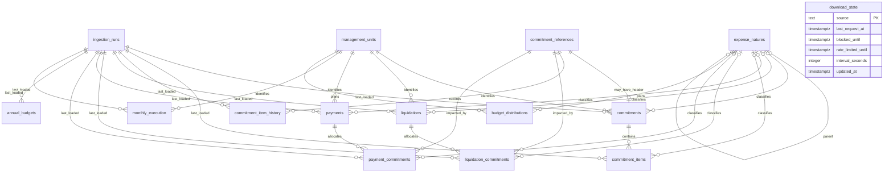

# Financial data model

Status: the database foundation, daily/monthly/annual Go importers and automatic
downloads with persistent pacing are implemented.
See [Finance ETL](../apps/etl/README.md) for commands and verification. Financial
API endpoints, calculations and UI are subsequent phases.

## Architecture and ownership

Use the existing Contracts Ext PostgreSQL database, with a dedicated `finance`
schema. The Go ETL imports public data directly into this schema. Fastify queries
it and owns internal planning. No runtime calls to SAGA or to the envelopa API are
required. The envelopa repository supplies extraction and source-mapping references.

Contracts Ext owns the SQL migration history. Both programs use qualified table
names and the same versioned database contract. The ETL must check that the required
migration is installed before loading; it must not create tables on startup.

Use separate database roles when wiring the ETL: grant schema usage and DML/sequence
access to the imported tables listed below, and no DDL. Do not grant the ETL writes
to `finance.budget_distributions` or the existing `public` tables. API access to
imported tables should be read-only; internal planning needs its own write access.
Role creation and credentials are deployment tasks, not part of this migration.

## Tables and source mapping

| Table | Purpose / reference in envelopa | Owner |
|---|---|---|
| `management_units` | Unit and management codes/names from daily and monthly files | ETL |
| `expense_natures` | Six-digit expense nature and optional eight-digit subelement | ETL; API may add an internally needed classification |
| `ingestion_runs` | Import attempt, file, period, scope, checksum, ETL version and outcome | ETL |
| `commitment_references` | Full commitment identity, independent of header availability | ETL |
| `commitments` | `Commitment`: document header, original values, supplier and process | ETL |
| `commitment_items` | `CommitmentItem`: item, classification, quantity and current values | ETL |
| `commitment_item_history` | `CommitmentItemsHistory`: original issuance, reinforcements, cancellations and other source operations | ETL |
| `liquidations` | `Liquidation`: liquidation document header | ETL |
| `liquidation_commitments` | `LiquidationImpactedCommitment`: amounts allocated to each commitment/classification | ETL |
| `payments` | `Payment`: payment header, process, original currency conversion and extra-budgetary flag | ETL |
| `payment_commitments` | `PaymentImpactedCommitment`: amounts allocated to each commitment/classification | ETL |
| `annual_budgets` | `ExpenseBudget`: annual institutional budget, including initial and updated allocation | ETL |
| `monthly_execution` | `ExpenseExecution`: monthly execution and outstanding-payables aggregates | ETL |
| `budget_distributions` | Internal annual estimate/release by unit and nature, corresponding to SAGA's distribution concept | API |
| `download_state` | Persistent request timestamp, shared cooldowns and adaptive interval across download processes | ETL |

Source models are under `internal/domain/model/` in envelopa; column mapping is in
`internal/infrastructure/client/portal/mapper.go`. Contracts Ext's schema is not a
copy of those structs. For example, envelopa's monthly `ExpenseCategoryCode` maps
the CSV expense **element**, not the economic category; the target names this
dimension `expense_element_code`. Alphanumeric action codes remain text.

## Relationships

All diagram edges below represent physical foreign keys. The optional commitment
header is intentional. A reference is not a fabricated commitment document.



There is no payment-to-liquidation FK: the examined source links these documents
to commitments, and does not supply a reliable direct settlement relationship.
Likewise there is no forced link to contracts or price records: matching a supplier,
unit or process alone does not establish that relationship.

History refers to `(commitment_id, item_sequential)` logically, and physically to
the commitment reference. An operation remains available if the current item or
header has not been loaded or no longer appears in a current snapshot. Queries
must use a left join to resolve the current item.

## Identity and reimport contract

- Management unit identity is `(management_code, code)`. Codes are strings so
  leading zeros survive. Do not assume UASG from the purchasing catalog is always
  the same financial management unit; any cross-module association needs evidence.
- An expense nature has six or eight digits. An eight-digit code must point to
  its existing six-digit parent. Upsert the parent before the child. A missing
  classification is `NULL`, not zero, an empty string or a manufactured code.
- Commitment identity is `(source, document_code)` in `commitment_references`.
  Use the complete source code, including the unit/management/year scope.
  A shortened `2025NE000001` is display data, never a global identifier.
- The commitment header shares the reference's ID. A payment, liquidation or
  historical operation may insert the reference first; a later header fills the
  same identity without changing existing links. Missing headers are discoverable
  with a left join and must not silently disappear from financial totals.
- Liquidations and payments each use `(source, document_code)`; a document may
  affect multiple commitments, and a commitment may receive multiple documents.
- Current item identity is `(commitment_id, sequential)`. Keep current item
  values separate from operation history; do not add both together.
- History uses `(commitment_id, source_key)`. Prefer a stable source operation ID.
  If none exists, use a canonical representation of the entire source row plus a
  deterministic occurrence ordinal for identical rows, independent of ZIP filename
  and input row order. Same-day operations must not collapse solely because their
  date/type/item match. This normalization must have fixtures before ETL release.
- Impact identity is `(document_id, commitment_id, expense_nature_code,
  subitem_code)`. PostgreSQL 16's `UNIQUE NULLS NOT DISTINCT` also protects imports
  with missing classification. Group repeated input rows at this exact granularity
  before upserting; update amounts to the new source totals, never increment on
  every replay. Preserve descriptions separately from subitem codes.
- Annual and monthly uniqueness includes all stored classification dimensions,
  including economic category, superior/subordinate agency, action, location and
  amendment author where present. Nullable monthly dimensions use the same
  null-aware uniqueness. Aggregate repeated source rows before writing.
- Every imported fact points to its **last** ingestion attempt. The audit table
  retains separate attempts, including failures; it is not a complete row-version
  history. `source_data` preserves the source fields alongside typed query columns.

## Load transactions and data lifecycle

1. Record an `IN_PROGRESS` attempt with nonempty scope, source file, period and ETL
   version. Set checksum when the downloaded file is available. Types distinguish
   `DAILY_EXPENSES`, `MONTHLY_EXECUTION` and `ANNUAL_BUDGET`.
2. Normalize decimal/date/code fields and reject nonfinite amounts. Source dates
   become `date`; audit times use `timestamptz`. Convert decimal strings with exact
   decimal arithmetic in Go, not `float64`. Missing amounts stay `NULL`; zero is a
   known amount. Signed corrections are supported. Reject precision overflow and
   excess scale before insert rather than silently relying on SQL rounding.
3. Serialize overlapping loads with source-wide advisory locks. The daily importer
   implements this using a session lock held across parsing and loading; a global
   lock also covers overlapping management/unit scopes. It compares archive dates
   before refreshing a document, preventing older snapshots from replacing newer
   headers/children. Automatic downloads also use `download_state` with short row
   locks and database time to coordinate request starts and penalties across
   processes. A pending server block survives worker restarts and retry exhaustion.
   Traffic from other databases/services using the same public IP is outside this gate.
4. In a transaction, upsert dimensions and references, then documents and children.
   Refresh a document's child set only from a complete source snapshot; remove
   obsolete child rows explicitly in that transaction. Preserve history/references.
   Do not delete a day's commitments just because the next day omits them.
5. Annual and monthly files are independently refreshed snapshots. Replace only
   the requested agency/year or management-unit/month scope, and only after a
   complete extraction. Never clear other scopes after an empty/failed download.
6. Mark a fully committed attempt `SUCCESS` or `NO_DATA` with a finish time. If a
   multi-unit attempt commits in separate unit transactions, `SUCCESS` requires all
   units to finish. Failed attempts retain partial progress counts and error details;
   retries upsert already committed units. After rollback, mark the attempt `FAILURE`
   in a separate transaction. A failure must not erase the last usable facts.

No financial fact uses automatic cascading deletion. Imported audit records cannot
be deleted while referenced. API and ETL writes maintain `updated_at` explicitly;
defaults only cover insertion. Dataset retention and audit pruning need an explicit
future policy, not cascading deletes.

## Query boundaries and outstanding payables

Daily documents, monthly aggregates and annual budgets are three independent
sources. Never union/add their amounts as if they were disjoint transactions.
Choose a source per report and label its period and last successful load.

Aggregate liquidation/payment impacts independently by commitment and classification
before joining: joining both raw child sets multiplies rows. Include references
with missing headers and distinguish commitment fiscal year from movement date.
Payments from a later year must retain their connection to an older commitment.
Do not infer the commitment's fiscal year from the payment's emission date.

Outstanding-payables source fields (`registered_payables_value_brl`,
`canceled_payables_value_brl`, `outstanding_value_liquidated_brl`,
`outstanding_value_paid_brl`) retain the existing envelopa mapping. They describe
source movements concerning prior-year obligations; they are not a persisted
application account balance. Do not sum repeated registration/cancellation amounts
from liquidation and payment datasets without validating their source semantics.

No `accounts_payable` balance table or computed balance view is created. The user
defined accounts payable as accumulated unpaid obligations; whether that includes
unliquidated commitments remains undecided. The schema keeps the inputs needed
for either definition without committing to a formula or clamping negative values.

## Annual budget versus internal campus distribution

The annual file contains budgetary-unit and agency codes, not management-unit or
campus allocation. Store its real category/group/element dimensions. The source
lacks application modality, so do not manufacture a six-digit nature by inserting
`90` or join it to a campus through a similarly named code.

`budget_distributions` separately stores one `ESTIMATE` and one `RELEASE` per
unit/year/nature, using UUIDs generated by the API. It has no FK to an arbitrary
annual budget row; the allocation method across actions and campuses is not yet
defined. Current amounts are stored here; approval workflows, adjustment history
and allocation policy are later features. No ETL refresh touches these values.

## Verification and rollout

Migration: `apps/api/migrations/202611050001_financial_foundation.sql`.
Shared download control: `apps/api/migrations/202611050002_financial_download_control.sql`.
Apply through the existing migration runner (`pnpm db:migrate`), not Go startup.
The migration is additive; existing catalog/contract tables and historical SQL
files stay unchanged. This phase does not migrate JSON catalog supplements into
financial facts or populate public data.

Focused verification:

```sh
pnpm --filter @contracts/api exec tsx --test test/integration/finance.test.ts test/integration/persistence.test.ts
```

These tests create randomly named temporary **databases**, because `search_path`
alone cannot isolate a migration that creates a named schema. The configured local
test PostgreSQL role needs `CREATEDB`. Databases are removed during teardown; no
financial migration is applied to the configured application database by these tests.
Coverage includes empty install, upgrade preserving existing data, migration replay,
out-of-order documents, cross-year links, partial payments, null-aware reimport,
classification integrity, exact decimals, transactional rollback, independent annual
budgets/internal distributions, monthly dimensions and existing persistence behavior.

The Go importers have separate unit and PostgreSQL integration tests covering
the load contract, including stale-child removal, failed/overlapping imports and
older snapshots. A cached real Portal ZIP dated 2026-09-30 was loaded and replayed
in an isolated database for management 26421: 255 fact rows per attempt, without
replay duplication. The reference headers include multiple/unknown classifications,
which are retained in raw data instead of manufactured into numeric nature codes.
The real September 2026 monthly archive was also loaded and replayed: 404 grouped
facts per attempt. A real automatic annual-budget download was imported on
2026-11-05: 100 grouped facts for agency 26421 and fiscal year 2026. Snapshot
cleanup is limited to represented agency/year or management-unit/month scopes.
Internal planning remains untouched. Downloader tests simulate HTTP redirects,
rate limits, server delays, interrupted transfers and invalid files, plus real
database pacing across independent connections. Scheduling is external; the CLI
supports one period or an inclusive period-start range.
